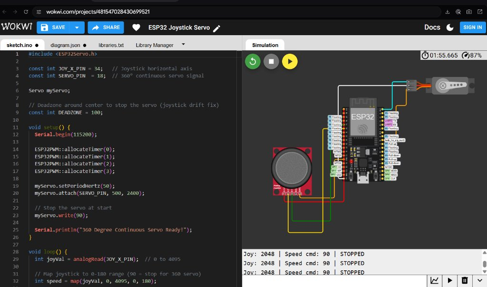

# 🕹️ ESP32 Joystick-Controlled 360° Servo Motor

An ESP32 project that uses an **analog joystick** to control a **360° continuous rotation servo motor**. Built and simulated on [Wokwi](https://wokwi.com).

## 🎮 Live Simulation

▶️ **[Run the Live Simulation on Wokwi](https://wokwi.com/projects/481547028430699521)**

Click the link above, press the green **Play** button, and drag the joystick to control the servo!

## 📸 Simulation Screenshot

## 🔧 How It Works

| Joystick Position | Servo Behaviour |
|---|---|
| ⬅️ Full Left | Full speed **Clockwise** |
| 🔘 Center | **Stopped** |
| ➡️ Full Right | Full speed **Counter-Clockwise** |
| Slight Left/Right | Slow spin either way |

The joystick's analog output (0–4095) is mapped to a servo command (0–180), where **90 = stop**, values below 90 spin one way, and values above 90 spin the other way.

## 🔌 Hardware Connections

### Joystick → ESP32

| Joystick Pin | ESP32 Pin | Wire Color |
|---|---|---|
| VCC | 3.3V | 🔴 Red |
| GND | GND | ⚫ Black |
| VRx (Horizontal) | GPIO 34 | 🟢 Green |
| VRy (Vertical) | GPIO 35 | 🔵 Blue |

### Servo → ESP32

| Servo Wire | ESP32 Pin | Wire Color |
|---|---|---|
| VCC (Red) | VIN / 5V | 🔴 Red |
| GND (Brown/Black) | GND | ⚫ Black |
| Signal (Orange) | GPIO 18 | 🟠 Orange |

## 📁 Project Files

| File | Description |
|---|---|
| `sketch.ino` | Arduino sketch (ESP32 firmware) |
| `diagram.json` | Wokwi circuit diagram |
| `libraries.txt` | Required Arduino library (ESP32Servo) |

## ⚠️ Notes

- **Servo needs 5V** — use the `VIN` pin, not `3.3V`
- **Joystick needs 3.3V** — ESP32 ADC only handles up to 3.3V
- **GPIO 34 & 35** are input-only pins — perfect for analog reads
- A **deadzone** is applied around center to prevent servo drift when joystick is idle

## 🛠️ Built With

- [ESP32 DevKit C V4](https://docs.espressif.com/projects/esp-idf/en/latest/esp32/)
- [ESP32Servo Library](https://github.com/madhephaestus/ESP32Servo)
- [Wokwi Simulator](https://wokwi.com)

## 📝 License

This project is open source and available under the [MIT License](LICENSE).
